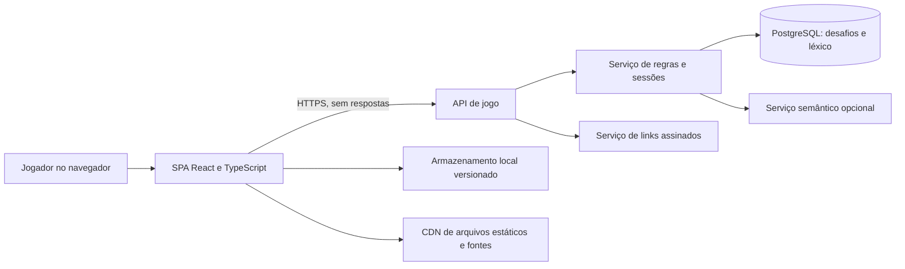

# Projeto Técnico — Entrelinhas

**Status:** proposta para validação  
**Base:** [PRD.md](PRD.md) e protótipo em [mockups.html](mockups.html)  
**Data:** 13 de outubro de 2026

## 1. Objetivo e premissas

Este documento descreve uma implementação web do jogo para navegador, em português brasileiro, sem cadastro obrigatório. O produto terá o modo Letras, nos formatos Solo, Dueto e Quarteto, e o modo Significados; desafios diários e anteriores; compartilhamento por link; progresso local; acessibilidade; e espaço para anúncios discretos.

O workspace ainda não contém uma aplicação ou stack de produção. As tecnologias abaixo são uma proposta inicial e podem ser substituídas antes da implementação.

**Design:** os três conceitos de `mockups.html` ainda não foram escolhidos formalmente. Esta proposta usa **Oficina** como tema padrão, por ser o tema inicial e a recomendação de design, e mantém **Fliperama** e **Jornal** como variações visuais opcionais. Os temas usam os mesmos componentes e não alteram as regras do jogo. As abas de conceitos do protótipo são apenas controles de revisão e não devem aparecer no produto final, a menos que a opção de trocar o tema seja aprovada.

## 2. Diretrizes de arquitetura

- Separar regras de jogo, interface, acesso a dados e apresentação visual.
- Manter respostas e dados semânticos secretos no servidor; a aplicação cliente recebe apenas o necessário para exibir pistas.
- Não exigir identidade para jogar. Usar um identificador aleatório de sessão, sem perfil público.
- Fazer do desafio uma unidade determinística identificada por data, idioma, modo, formato e dificuldade.
- Tratar cada palpite de Dueto/Quarteto como uma única tentativa compartilhada entre todos os alvos ainda ativos.
- Isolar ranking semântico atrás de um serviço e de uma flag de funcionalidade até validar qualidade e custo em português brasileiro.
- Carregar o tema visual por tokens CSS; não duplicar os componentes de partida para cada conceito.

## 3. Stack proposta

| Camada | Proposta | Responsabilidade |
| --- | --- | --- |
| Interface | React, TypeScript e Vite | SPA responsiva, componentes acessíveis e estado de tela |
| Estilos | CSS Modules ou CSS por componente com propriedades customizadas | Layout, design tokens e temas Oficina/Fliperama/Jornal |
| API | Node.js, TypeScript e Fastify | Sessões, validação de palpites, feedback, desafios e compartilhamento |
| Persistência | PostgreSQL | Catálogo de desafios, léxico, sessões anônimas e resultados compartilháveis |
| Distribuição | CDN para a SPA e serviço HTTPS para a API | Entrega de arquivos estáticos e chamadas de jogo |
| Testes | Vitest, React Testing Library, Playwright e axe-core | Lógica, componentes, jornadas e verificações de acessibilidade |

As fontes usadas na interface devem ser empacotadas localmente após a verificação das licenças, em vez de carregadas de um provedor externo em produção. O provedor de hospedagem, a solução de anúncios e o custo operacional permanecem decisões abertas.

## 4. Visão da arquitetura



O navegador desenha os tabuleiros e armazena preferências e estatísticas locais. A API escolhe o desafio, valida cada palpite e devolve feedback por alvo. Os alvos secretos não devem ser incluídos no HTML, nos arquivos JavaScript, nos parâmetros da URL ou na resposta de carregamento do desafio.

## 5. Organização do código

Uma separação inicial recomendada:

```text
src/
  app/                 # roteamento, provedores e inicialização
  components/          # controles reutilizáveis e diálogos acessíveis
  features/
    game/              # tela, estado e componentes da partida
    archive/            # seleção de desafios anteriores
    stats/              # estatísticas locais
    sharing/            # criação e abertura de links
  design/
    tokens.css          # tokens semânticos
    themes.css          # Oficina, Fliperama e Jornal
  services/             # cliente HTTP, armazenamento e configuração
  domain/               # tipos e regras puras compartilhadas
server/
  src/
    routes/             # rotas HTTP
    game/               # validação, tentativas e avaliação de letras
    semantic/           # ranking e dicas, habilitados por flag
    sharing/            # tokens de comparação
    persistence/        # repositórios e migrações
  tests/
data/
  lexicon/              # dados de vocabulário licenciados e versionados
  challenges/           # ferramenta para preparar desafios diários
```

O protótipo HTML é material de referência visual e comportamental. A implementação de produção deve separar a estrutura, os estilos e a lógica em módulos testáveis.

## 6. Modelo de domínio

### Tipos principais

```ts
type GameMode = "letters" | "meaning";
type LetterFormat = "solo" | "duet" | "quartet";
type Difficulty = "easy" | "normal" | "hard";
type TileState = "correct" | "present" | "absent";
type GameStatus = "loading" | "playing" | "won" | "lost" | "error";

interface ChallengeKey {
  date: string;
  locale: "pt-BR";
  mode: GameMode;
  format: LetterFormat;
  difficulty: Difficulty;
}
```

`format` só afeta o modo `letters`; no modo `meaning`, a API o normaliza para `solo`. A chave completa deve ser usada para consultar, arquivar e compartilhar a mesma partida sem ambiguidades.

### Sessão de jogo

O estado de tela deve ser explícito e serializável:

- `challenge`: identificador, data, modo, formato, dificuldade, tamanho da palavra e tentativas permitidas.
- `guesses`: sequência de palpites enviados e índice da tentativa.
- `targets`: posição, estado resolvido e feedback mais recente de cada alvo; nunca guardar a resposta no estado público.
- `draft`: texto ainda não enviado.
- `status`: carregando, em jogo, vitória, derrota ou erro recuperável.
- `hintsUsed`: dicas usadas no modo Significados.

Mudanças de modo, formato ou dificuldade começam uma nova partida e limpam o estado da partida anterior. Recarregar a página deve restaurar uma sessão ativa usando o identificador opaco da sessão e o armazenamento local versionado.

## 7. Regras dos modos

### 7.1 Letras, Solo, Dueto e Quarteto

| Dificuldade | Solo | Dueto | Quarteto |
| --- | ---: | ---: | ---: |
| Fácil | 8 palpites | 9 compartilhados | 10 compartilhados |
| Normal | 6 palpites | 7 compartilhados | 9 compartilhados |
| Difícil | 5 palpites | 6 compartilhados | 8 compartilhados |

- Cada alvo tem cinco letras e um conjunto de respostas preparado para `pt-BR`.
- Um palpite válido é avaliado contra todos os alvos não resolvidos e consome uma única tentativa global.
- Quando uma resposta é encontrada, aquele tabuleiro fica congelado. O palpite seguinte continua nos demais alvos.
- A partida termina em vitória quando todos os alvos forem encontrados; termina em derrota quando o orçamento compartilhado acabar.
- Em derrota, a API devolve as respostas restantes somente no resultado final.
- A dificuldade deve controlar tanto o orçamento de palpites quanto a familiaridade das palavras, seguindo o catálogo editorial.

### 7.2 Avaliação de letras repetidas

Normalizar as palavras para comparação, mas conservar a forma original para apresentação. A avaliação deve ocorrer em duas passagens:

1. Marcar como `correct` todas as letras que coincidem na posição e subtrair essas ocorrências do inventário da resposta.
2. Para cada posição ainda não marcada, marcar como `present` somente se restar uma ocorrência daquela letra no inventário; consumir a ocorrência usada.
3. Marcar as demais como `absent`.

Isso evita indicar como presente mais cópias de uma letra do que realmente existem na resposta. Deve haver teste de unidade para combinações com letras repetidas.

### 7.3 Normalização do português

- Converter para Unicode NFC para armazenamento e NFD temporariamente para comparação sem acento.
- Ignorar diferenças de caixa e diacríticos na comparação, de acordo com a regra escolhida para o jogo.
- Contar letras após normalização; validar explicitamente `ç`, acentos, hífen, espaço e caracteres permitidos.
- Manter forma exibida, forma normalizada e forma de busca como campos distintos no léxico.
- A lista de respostas e a lista de palpites aceitos devem ser diferentes: uma palavra válida para palpite não precisa ser selecionável como resposta.
- Registrar fonte, licença, versão e revisão editorial do dicionário.

### 7.4 Significados

- O cliente envia um palpite de palavra e recebe um ranking numérico, um rótulo textual e, quando permitido, uma dica.
- Números menores indicam maior proximidade; a tela deve explicar essa convenção e não sugerir uma precisão linguística que o modelo não tenha.
- A dificuldade seleciona resposta e quantidade de dicas: Fácil até três, Normal uma, Difícil nenhuma, conforme a proposta do PRD.
- Não chamar um LLM externo a cada palpite. Usar vocabulário e vetores versionados, com cálculo hospedado pela API ou ranking pré-computado por desafio.
- Manter a funcionalidade atrás de flag até que falantes de português brasileiro validem relevância dos rankings, polissemia e tratamento de regionalismos.
- Se a qualidade não atingir o critério acordado, lançar primeiro Letras e deixar Significados indisponível sem comprometer o restante do produto.

## 8. API proposta

Todas as rotas usam HTTPS, JSON, versionamento `/api/v1` e respostas com `requestId` para suporte. Exemplos de nomes; contratos finais devem ser versionados.

| Método e rota | Uso | Dados que não pode expor |
| --- | --- | --- |
| `GET /api/v1/challenges/daily` | Carregar desafio por modo, formato e dificuldade | Respostas, léxico secreto, vetores/ranking completo |
| `GET /api/v1/challenges/archive` | Listar datas disponíveis para filtros escolhidos | Respostas de datas futuras ou ainda não jogadas |
| `GET /api/v1/challenges/:id` | Carregar metadados de desafio anterior ou compartilhado | Respostas antes da conclusão |
| `POST /api/v1/games` | Criar ou retomar sessão anônima para um desafio | Identidade pessoal |
| `POST /api/v1/games/:id/guesses` | Validar palpite e retornar feedback por alvo | Resposta de alvo ainda não resolvido |
| `POST /api/v1/games/:id/hints` | Solicitar dica quando houver saldo | Dicas futuras não liberadas |
| `POST /api/v1/games/:id/share` | Criar token de comparação depois do resultado | Nome, e-mail ou resposta secreta |
| `GET /api/v1/shares/:token` | Reabrir o mesmo desafio e resumo compartilhado | Dados pessoais do remetente |

Exemplo de metadados de desafio antes de jogar:

```json
{
  "challengeId": "opaque-id",
  "date": "2026-10-13",
  "locale": "pt-BR",
  "mode": "letters",
  "format": "duet",
  "difficulty": "normal",
  "wordLength": 5,
  "targetCount": 2,
  "attemptsAllowed": 7
}
```

Exemplo de resposta após um palpite válido:

```json
{
  "attemptsUsed": 1,
  "attemptsRemaining": 6,
  "targets": [
    { "index": 0, "states": ["correct", "absent", "present", "absent", "correct"], "solved": false },
    { "index": 1, "states": ["present", "absent", "absent", "correct", "correct"], "solved": false }
  ],
  "gameStatus": "playing"
}
```

Para erros previsíveis, usar códigos estáveis (`INVALID_WORD_LENGTH`, `WORD_NOT_ALLOWED`, `DUPLICATE_GUESS`, `ATTEMPTS_EXHAUSTED`) e mensagens localizadas no cliente. Um palpite rejeitado não consome tentativa.

## 9. Compartilhamento e privacidade

- A URL usa identificador opaco do desafio, modo, formato e dificuldade; nunca contém respostas ou texto de palpite.
- Para comparar resultados sem conta, gerar um token assinado com `challengeId`, desempenho final e versão do formato. O token não carrega nome ou outro dado pessoal.
- Tratar o token como resumo compartilhável, não como prova competitiva: sem cadastro, o servidor não pode garantir a identidade nem impedir completamente resultados adulterados pelo próprio jogador.
- Aplicar limite de requisições por sessão e desafio para reduzir raspagem de respostas e abuso automatizado.
- Usar sessão aleatória, cookies `Secure`, `HttpOnly` e `SameSite` quando aplicável; não usar fingerprinting.
- Remover ou expirar sessões anônimas e tokens de comparação após prazo definido; não guardar palpites brutos em logs analíticos.
- Revisar LGPD, regras para menores e política do provedor de anúncios antes de habilitar monetização. Anúncios devem ser contextuais/não personalizados e nunca cobrir tabuleiro, teclado ou fluxo de tentativa.

## 10. Persistência e modelo de dados

Proposta inicial de entidades relacionais:

| Entidade | Campos principais | Observações |
| --- | --- | --- |
| `challenge` | `id`, `date`, `locale`, `mode`, `format`, `difficulty`, `attempt_limit`, `lexicon_version` | Restrição única na combinação da chave diária |
| `challenge_target` | `challenge_id`, `position`, `answer_word_id`, `semantic_model_version` | Tabela privada; não retornar diretamente à SPA |
| `lexicon_word` | `id`, `locale`, `display_form`, `normalized_form`, `frequency_band`, `is_guess_allowed`, `is_answer_allowed` | Fonte e licença documentadas |
| `game_session` | `id`, `challenge_id`, `status`, `attempts_used`, `expires_at` | Sessão anônima com retenção curta |
| `game_guess` | `session_id`, `attempt_index`, `normalized_guess`, `created_at` | Persistir somente o necessário para retomada e auditoria |
| `share_token` | `token_hash`, `challenge_id`, `result_summary`, `expires_at` | Armazenar hash do token, nunca token em texto puro |

No navegador, guardar em `localStorage` versionado apenas preferências, estatísticas locais e referência opaca para sessão ativa. Não armazenar a resposta nem considerar dados locais como confiáveis para ranking. Mudanças de esquema local devem ter migração e fallback de limpeza.

## 11. Interface e implementação visual

### Componentes

- `GameHeader`: marca, data/desafio, arquivo e estatísticas.
- `ModeSelector`: Letras/Significados.
- `LetterFormatSelector`: Solo/Dueto/Quarteto, visível somente em Letras.
- `DifficultySelector`: Fácil/Normal/Difícil e resumo do que muda.
- `LetterBoards`: um, dois ou quatro tabuleiros; cada alvo mostra estado próprio e pode ser congelado.
- `GuessInput` e `LetterKeyboard`: entrada física, teclado virtual, validação e foco.
- `SemanticGuessPanel`: campo livre, ranking, dicas restantes e histórico.
- `GameResult`, `ArchiveDialog`, `StatsDialog` e `ShareDialog`.
- `AdSlot`: espaço reservado fora da área de jogo; carregamento somente após consentimento e configuração legal.

### Design tokens

Definir tokens semânticos para fundo, superfície, texto, texto secundário, borda, destaque, correto, presente, ausente, tipografia, raio e foco. Oficina é a configuração inicial recomendada; Fliperama e Jornal sobrescrevem tokens e fontes, mas reutilizam os mesmos componentes.

O estado da letra sempre inclui um símbolo ou texto além da cor. Em Solo, usar uma coluna central; em Dueto, dois tabuleiros lado a lado; em Quarteto, uma matriz 2 × 2. Em telas estreitas, manter dois tabuleiros por linha somente se a casa continuar legível; caso contrário, empilhar e preservar rolagem vertical. Não reduzir a fonte do texto com unidades de viewport.

### Acessibilidade

- HTML semântico, rótulos persistentes, regiões nomeadas e títulos hierárquicos.
- Tabuleiros estáticos como grupos/listas nomeados; não declarar `role="grid"` sem implementar navegação de grade por setas.
- Foco visível, operação por teclado e retorno de foco ao fechar diálogos.
- Anunciar uma vez o resultado do palpite e tentativas restantes por `aria-live`; não anunciar cada tecla enquanto a pessoa digita.
- Não comunicar estado apenas por cor; símbolos/descrições textuais devem ser visíveis e acessíveis a leitores de tela.
- Respeitar `prefers-reduced-motion`, zoom e reflow; anúncios não podem cobrir controles.
- Validar WCAG 2.2 AA com ferramenta automática e revisão manual em teclado e leitor de tela. Ferramenta automática isolada não certifica conformidade.

## 12. Segurança, disponibilidade e desempenho

- Restringir CORS ao domínio do jogo; configurar CSP, `X-Content-Type-Options`, HTTPS e validação de entrada no servidor.
- Rate limit para criação de sessão, tentativa e compartilhamento; limite de tamanho para campos e tokens.
- Não aceitar do cliente tentativas restantes, resultados ou estados de tabuleiro como autoridade.
- Ter cache de metadados públicos de desafio; manter respostas e segredo semântico fora de cache público.
- Se a API ficar indisponível, preservar o rascunho local e oferecer retomada/reenvio sem consumir tentativa duplicada; usar chave idempotente por envio.
- Meta inicial: carregamento da interface sem fontes ou anúncios bloqueantes; acompanhar LCP, INP e CLS em celular de entrada antes de fixar SLOs.
- Preparar cópias de segurança do banco e processo de publicação/rollback do catálogo diário antes de produção.

## 13. Telemetria

Eventos mínimos, agregados por desafio e sem texto de palpite:

- `challenge_started`: modo, formato, dificuldade e dispositivo em faixa ampla.
- `guess_accepted` / `guess_rejected`: índice da tentativa e código de motivo; nunca a palavra enviada.
- `target_solved` e `game_finished`: número de alvos, tentativas e resultado.
- `archive_opened`, `share_created`, `share_opened`.
- `semantic_hint_used`: dificuldade e número da dica.

Definir retenção, consentimento, amostragem e possibilidade de desligar telemetria. Não usar a telemetria de gameplay para segmentação publicitária de adolescentes.

## 14. Estratégia de testes

### Unitários

- Normalização de acentos e validação do comprimento.
- Algoritmo de feedback com letras repetidas.
- Orçamentos Solo/Dueto/Quarteto por dificuldade.
- Contagem compartilhada, congelamento de alvo e fim de jogo.
- Criação e verificação de tokens de compartilhamento.
- Ranking semântico em exemplos aprovados por revisão humana.

### Integração

- Contratos API e ausência de respostas em carregamento/erros.
- Todos os palpites de uma sessão contam no servidor exatamente uma vez.
- Arquivo retorna o mesmo desafio para a mesma chave.
- Link de compartilhamento restaura modo, formato, data, dificuldade e resumo.
- Expiração de sessões e tokens.

### E2E e acessibilidade

- Jogar vitória e derrota nos três formatos, com resolução parcial em Dueto/Quarteto.
- Trocar modo/dificuldade e confirmar estados, tentativas e descrição atualizados.
- Abrir desafio arquivado e link compartilhado sem alterar sequência diária.
- Testar larguras 320, 390, 768 e 1365 CSS px, zoom, teclado e `prefers-reduced-motion`.
- Rodar axe-core e fazer revisão manual com NVDA/Firefox ou leitor equivalente.
- Inspecionar contraste para cada tema, estados de letra, foco e controles desabilitados.

## 15. Plano de implementação

1. **Fundação:** selecionar tema padrão, definir licença/fonte do léxico, fechar regras de acentos, data diária e faixa etária; configurar monorepo, lint, testes e pipeline.
2. **Letras Solo:** implementar API de desafio, sessões anônimas, dicionário, feedback correto para letras repetidas e UI Oficina acessível.
3. **Dueto/Quarteto:** adicionar tabuleiros compartilhados, budgets, arquivo, estado parcial resolvido e testes de desempenho em celular.
4. **Persistência e social:** estatísticas locais, retomada de sessão, links assinados e comparação sem spoiler.
5. **Significados:** protótipo técnico do ranking `pt-BR`, revisão linguística e avaliação de qualidade/custo; lançar somente após gate de qualidade.
6. **Monetização e lançamento:** revisão jurídica/privacidade, anúncios não personalizados em espaço reservado, monitoramento, rollback e teste gradual.

## 16. Critérios para liberar a primeira versão

- Todas as combinações de modo/formato/dificuldade entregam o limite correto e respostas estáveis para o dia.
- O servidor não revela alvo não resolvido em HTML, scripts, logs ou endpoints públicos.
- Letras repetidas geram feedback correto; rejeições não consomem tentativas.
- Dueto e Quarteto compartilham palpites, congelam tabuleiros resolvidos e funcionam nos breakpoints suportados.
- Links reproduzem o mesmo desafio e não contêm respostas ou dados pessoais.
- Estatísticas e progresso sobrevivem a recarga no mesmo navegador, com aviso de que não são sincronizados.
- Fluxos essenciais funcionam por teclado e leitor de tela; não há informação dependente somente de cor.
- Revisão de privacidade, público adolescente e formato dos anúncios está concluída antes de qualquer publicidade.

## 17. Decisões pendentes

- Confirmar oficialmente Oficina como tema de produção ou escolher Fliperama/Jornal; manter os demais como temas ou removê-los.
- Fechar stack/ambiente de hospedagem, orçamento mensal, disponibilidade e responsável operacional.
- Selecionar léxico com licença compatível e política editorial para flexões, gírias e regionalismos.
- Definir fuso oficial para o corte diário; proposta: `America/Sao_Paulo`, a validar com o público.
- Definir modelo/fonte dos vetores semânticos e critério de qualidade antes de habilitar Significados.
- Definir política de retenção para sessões anônimas e tokens compartilhados.
- Definir a faixa etária exata, consentimento e fornecedor/posicionamento dos anúncios com orientação jurídica.
- Definir SLOs, metas analíticas e política de incidentes após o primeiro teste fechado.